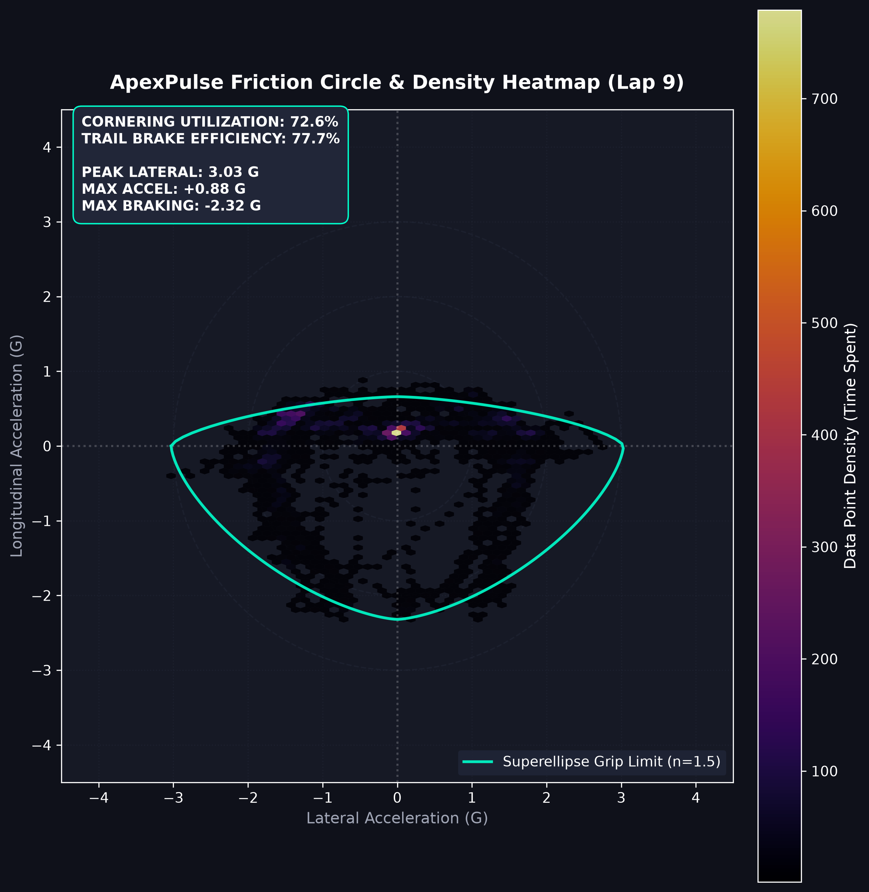

# ApexPulse | Track-Agnostic Telemetry & Dynamics Suite

**ApexPulse** is an automated telemetry engineering pipeline and vehicle dynamics analysis toolkit built for sim racing (Assetto Corsa Competizione) and real-world logging systems (e.g., MoTeC). Developed in Python using Pandas, NumPy, SciPy, FastDTW, Matplotlib, Plotly, and Streamlit, it converts raw time-series telemetry into normalized spatial datasets, $G\text{-}G$ plots, continuous spatial time-delta curves, and corner-by-corner performance breakdowns.

By decoupling analytical logic from circuit geometries through dynamic JSON configurations (`/tracks`), ApexPulse automatically detects track identity from dataset metadata and adapts to new circuits without any code modification.

---

## Key Technical Features

* **Zero-Touch Automated Data Pipeline:** Parses raw multi-row header metadata, applies rolling-median and zero-phase Butterworth filtering where timestamps support it, quarantines configured impossible speed/G samples, auto-detects track identity, and exports normalized datasets.
* **Shared Telemetry Ingestion:** Canonicalizes lap, distance, and speed channels, sorts samples, reports invalid and repeated-distance rows, and uses a single lap-distance definition across ingestion and comparison. Valid samples at repeated distances are retained for time-based analysis.
* **Interactive Session Dashboard:** Presents lap speed/delta, optional speed-profile DTW diagnostics, driver inputs, cross-session comparison, G-G sample density, track views, sector estimates, constrained optimal-lap analysis, tire metrics when channels exist, and data-quality details.
* **Reproducible Session Reports:** Writes a cleaned CSV, a data-quality JSON report, and a session report with selected-lap and sector comparisons.
* **Configurable Cubic-Spline Spatial Alignment:** Interpolates telemetry onto a uniform spatial grid (1 m by default); cubic splines preserve first- and second-derivative continuity, with a linear fallback when fewer than three unique samples are available.
* **Sample-Preserving Spatial Alignment:** Retains valid time samples even when distance is repeated at the logger's resolution, averaging by distance only for spatial interpolation.
* **Kinematic 2D Track Map Reconstruction:** Provides track visualization from logged GPS coordinates or an explicitly approximate path reconstructed from lateral acceleration when GPS is unavailable.
* **Vehicle Dynamics ($G\text{-}G$ Plots):** Visualizes lateral vs. longitudinal acceleration as sample density in the dashboard. The standalone friction-circle script also draws a superellipse envelope based on observed lap data; this is not a validated tire-grip limit.
* **Config-Driven Corner Sector Analysis:** Reads JSON distance gates to evaluate corner minimum speed ($\text{V-Min}$) and sector time deltas.
* **Automated Incomplete Lap Filtering:** Excludes laps below a configurable minimum distance-coverage threshold (90% by default) before analysis.
* **Physics-Guarded Optimal Lap:** Uses dynamic programming to select the fastest sector combination that meets a configured speed-continuity tolerance at each splice. This remains a modeled benchmark, not a validated full vehicle simulation.
* **Conditional Tire Analytics:** Computes observed G-G envelope area, inner/outer temperature gradient, and a steering-speed-lateral-G integral only when required channels are present; missing channels are reported rather than fabricated.

---

## Repository Architecture

    ApexPulse/
    ├── assets/                  # Example dark-theme analysis plots (.png)
    │   ├── driver_comparison.png
    │   ├── friction_circle_density.png
    │   ├── lap_comparison.png
    │   ├── math_channels.png
    │   ├── telemetry_traces.png
    │   ├── time_delta.png
    │   └── track_map.png
    ├── data/                    # Raw telemetry inputs and cleaned datasets (.csv)
    │   ├── clean_data.csv
    │   ├── data_with_math_channels.csv
    │   └── raw_telemetrySilverstone.csv
    ├── config.yaml              # Shared coverage, grid, filter, and physics defaults
    ├── src/
    │   ├── cli.py               # Configurable clean and dashboard commands
    │   ├── config.py            # YAML configuration loader
    │   ├── core/                # Analysis, optimal lap, derived channels, sector logic
    │   ├── pipeline/            # Telemetry ingestion and cleaning
    │   └── visualization/       # Dashboard, standalone plots, shared Matplotlib style
    ├── tests/                   # Telemetry, analysis, CLI, and dashboard tests
    ├── tracks/                  # Circuit sector configuration files (.json)
    │   ├── Barcelona.json
    │   ├── Bathurst.json
    │   ├── Imola.json
    │   ├── Monza.json
    │   ├── Nurburgring.json
    │   ├── Silverstone.json
    │   ├── Spa.json
    │   └── Suzuka.json
    ├── .github/workflows/       # Automated tests and compilation on pushes/PRs
    ├── .streamlit/              # Dashboard theme configuration
    ├── .vscode/settings.json    # Default project interpreter and Explorer exclusions
    ├── .gitignore               # System cache & build exclusion filters
    ├── README.md                # Project documentation
    └── requirements.txt         # Runtime dependencies

---

The source tree is divided into `src/pipeline/`, `src/core/`, and `src/visualization/`. Generated reports go in the ignored `reports/` folder; the local `.venv/` environment is also ignored and should not be committed.

## File Naming Convention

To enable zero-touch track detection, ensure your input CSV file includes the circuit name in its filename (e.g., `raw_telemetrySilverstone.csv`, `spa_session.csv`, or `monza_hotlap.csv`).

The pipeline parses the filename, tags the data, and loads the matching geometry configuration from `/tracks` automatically.

---

## Quickstart

### 1. Installation
Clone the repository and install required dependencies:

    git clone [https://github.com/ItzJTz/ApexPulse.git](https://github.com/ItzJTz/ApexPulse.git)
    cd ApexPulse
    py -3.11 -m venv .venv
    .\.venv\Scripts\python.exe -m pip install -r requirements.txt

In VS Code, select `.venv\Scripts\python.exe` with **Python: Select Interpreter** if it is not already selected. The workspace settings provide this as the default and hide `.venv` from the Explorer; `.gitignore` prevents it from being committed.

### 2. Clean a session and create reports

Run from the repository root. The input may be a raw MoTeC-style CSV or a previously cleaned CSV:

    .\.venv\Scripts\python.exe -m src.cli clean data\raw_telemetrySilverstone.csv --output-dir reports

The command writes three artifacts into `reports/`: a normalized, complete-lap CSV; a data-quality JSON file with quarantined rows, channel mappings, missing optional-channel rates, and lap coverage; and a session JSON report with lap, sector, and physically constrained optimal-lap analysis when enough valid laps are available. Use `--minimum-lap-fraction` to adjust the complete-lap threshold, or `--report-json path.json` to choose the session-report location. Defaults are centralized in `config.yaml`.

Track identity is resolved from the input filename or MoTeC `Venue` metadata against JSON files in `tracks/`. If the track is unknown, generic lap analysis still works, but track-specific sectors are not guessed.

### 3. Explore the session in one dashboard

Start the dashboard from the repository root:

    .\.venv\Scripts\python.exe -m src.cli dashboard

Then follow these steps:

1. In the left sidebar, either upload a telemetry CSV or choose a CSV already in `data/`. If a file is uploaded, it takes precedence over the local-file selector.
2. Set **Minimum lap coverage**. The default is 90%; increase it to exclude more partial laps or lower it only when appropriate for your session.
3. Select a **Reference lap** and a **Compared lap**. The dashboard initially selects the two fastest valid laps; you can change either selection.
4. Open the tabs to review the session:

   * **Overview:** lap speed traces and cumulative time delta. Positive delta means the compared lap is ahead. An optional DTW panel aligns speed-profile shape for diagnosis only; it does not modify the time delta.
   * **Driver inputs:** available throttle, brake, steering, and G channels aligned by distance.
   * **G-G:** measured lateral/longitudinal acceleration sample density. Brighter cells mean more samples in that acceleration range; empty ranges are blank. Lateral G is signed left/right. Longitudinal G is sign-inverted, so positive means acceleration and negative means braking. It does not claim to estimate a validated tire-grip envelope.
   * **Track map:** logged GPS positions when usable; otherwise an explicitly labeled approximate path from lateral acceleration.
   * **Sectors:** minimum speeds and distance-integrated sector times when the track is identified and a matching configuration is available.
   * **Data quality:** included/excluded laps, dropped/duplicate rows, optional-channel completeness, and downloads for the cleaned CSV and JSON report.
   * **Driver comparison:** upload a second session to compare its fastest complete lap with the fastest complete lap from the main session. Both files should be from the same circuit and use compatible distance units. If track metadata is missing, confirm this manually in the tab.
   * **Optimal lap:** uses dynamic programming to choose the fastest micro-sector combination within the configured seam-speed tolerance. It remains a theoretical benchmark assembled from different laps, not a full vehicle simulation.
   * **Tire analytics:** plots inner-minus-outer temperature against lateral G and reports per-lap G-G envelope area and steering-speed-lateral-G integral when those input channels are available. G-G area change defaults to the first and last valid laps; optional `tire_analysis.baseline_lap` and `tire_analysis.compare_lap` settings select specific available laps. Area change alone does not prove tire degradation.

5. Use the data-quality tab to check which laps and samples were retained before interpreting comparisons or downloading the cleaned data and report.

The dashboard reports sector times as estimates. A reconstructed path is not surveyed circuit geometry, and GPS coordinate values are shown as supplied by the data source. Track-specific sectors require the filename or source metadata to identify a track with a matching JSON configuration in `tracks/`.

To run the separate command-line sector report, provide a raw or cleaned CSV whose filename or Venue metadata identifies its track:

    python -m src.core.sector_analysis data/raw_telemetrySilverstone.csv

For the supplied Silverstone sample, this compares the last two complete laps. A generic filename such as `clean_data.csv` without Venue metadata cannot identify the circuit; use a track-named file or the original telemetry file instead.

The dashboard and command-line tools share lap alignment and telemetry processing. Synthetic-data unit tests cover fastest-lap selection, spatial alignment, repeated-distance handling, and optimal-lap calculations; real cross-driver sessions are still needed to validate results against actual driver data.

To compare two real sessions, provide one CSV for each driver. The script selects the fastest complete lap in each file, aligns the speed traces by distance, and saves the plot to `assets/driver_comparison.png`:

    .\.venv\Scripts\python.exe -m src.visualization.driver_comparison data\driverA_Silverstone.csv data\driverB_Silverstone.csv

Both files should be from the same circuit and use compatible distance units. Use `--output path\to\comparison.png` to choose a different image path. For a plot-only demo without a second driver's data, `--synthetic-benchmark` generates synthetic speed for Driver B; do not treat that result as a real driver comparison.

`python -m src.core.math_channels` generates the optional derived-channel plot. Its downforce multiplier, brake-bias value, and brake-active threshold are configured under `vehicle` in `config.yaml`; treat those channels as illustrative until calibrated for the vehicle. Tire analytics require corresponding temperature, acceleration, and steering signals; the dashboard explains which metrics cannot be calculated for a session. The optional DTW view matches speed-profile shape only and never replaces the distance-based lap delta.

### 4. Run automated checks

    .\.venv\Scripts\python.exe -m unittest discover -s tests -v
    .\.venv\Scripts\python.exe -m compileall -q src tests

GitHub Actions runs the same tests and Python compilation check for pushes and pull requests.
---

## Visual Analytics Showcase

### 1. Reconstructed 2D Track Map & Speed Heatmap

### 2. Multi-Channel Telemetry Dashboard

### 3. G-G Sample-Density Plot

### 4. Continuous Spatial Time-Delta Engine

### 5. Spatial Lap Comparison with Differential Shading

Creator: JT
Focus: Data Engineering | Vehicle Dynamics | GT Motorsport
