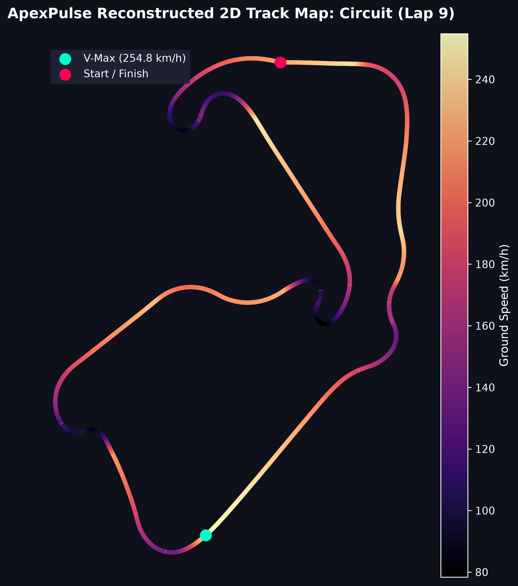
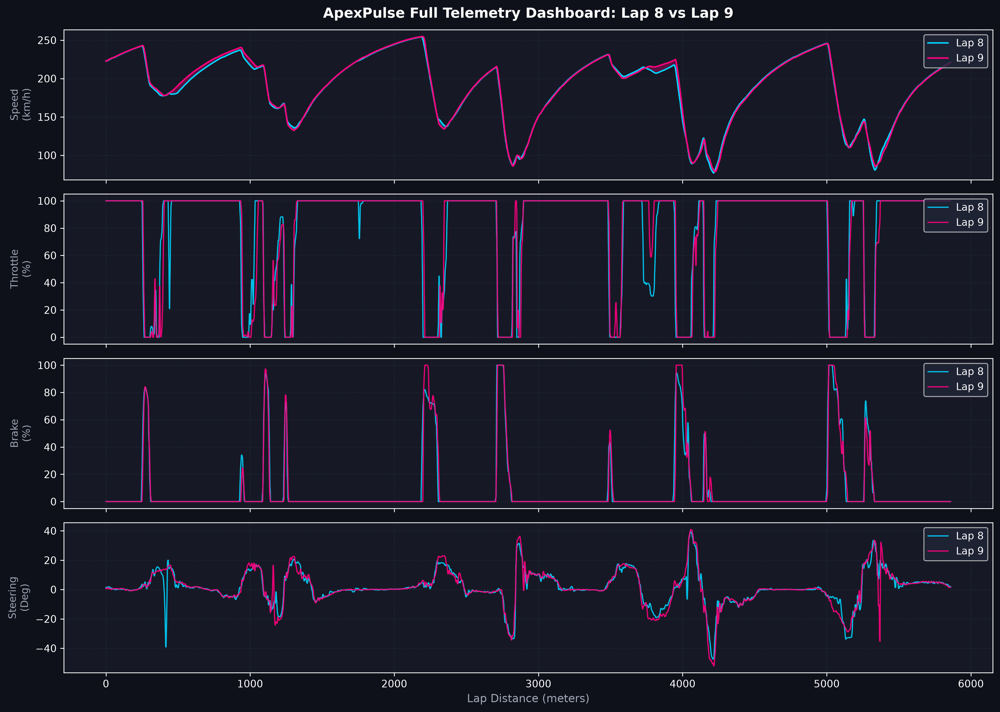
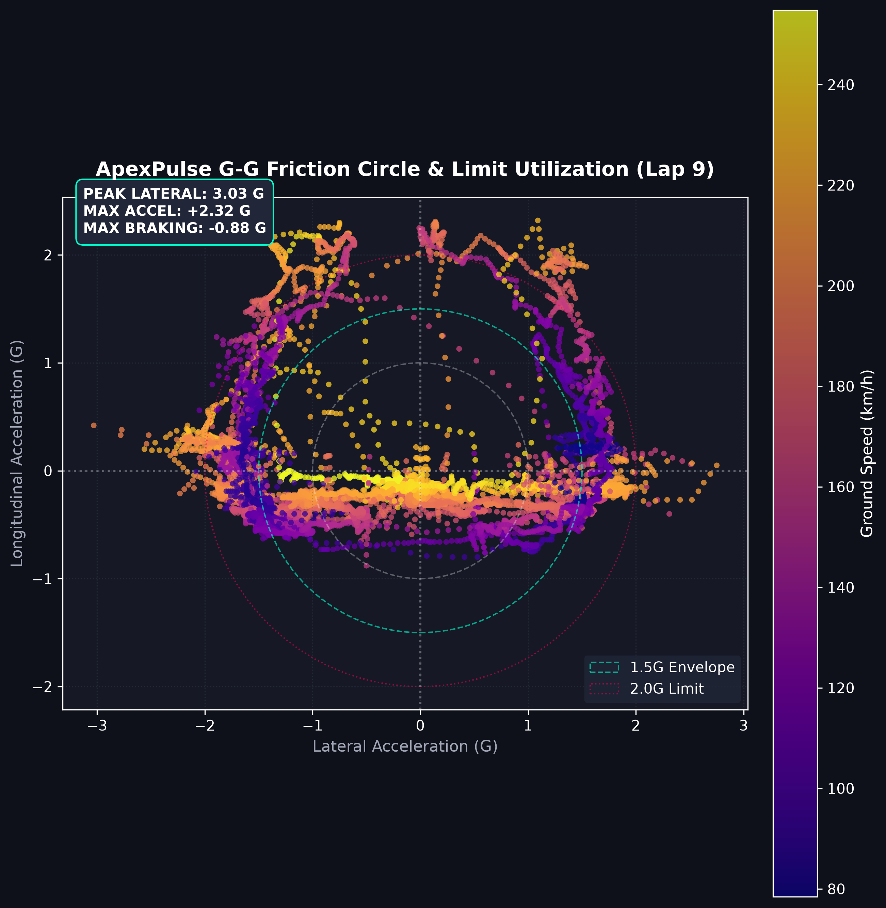
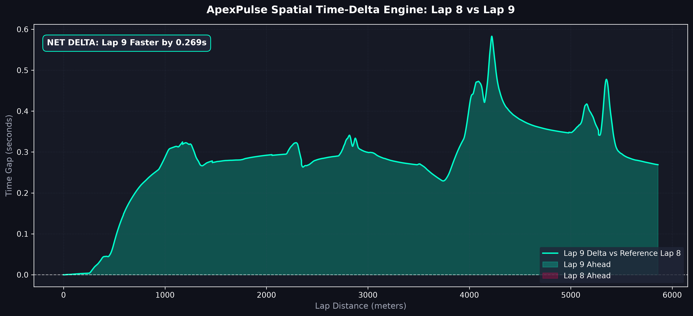
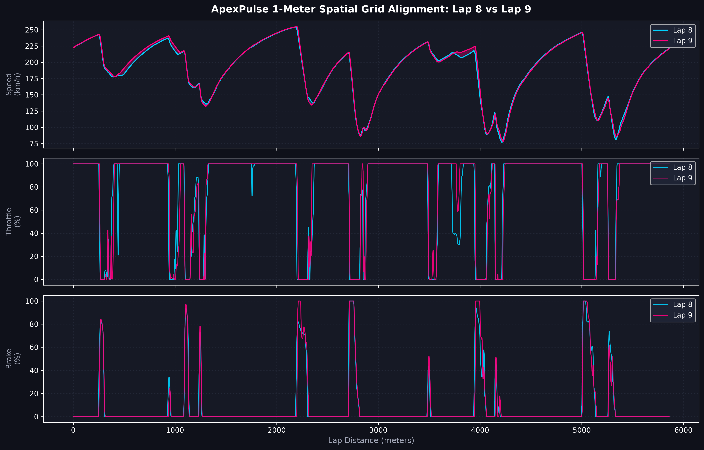

# ApexPulse | Track-Agnostic Telemetry & Dynamics Suite

**ApexPulse** is an automated telemetry engineering pipeline and vehicle dynamics analysis toolkit built for sim racing (Assetto Corsa Competizione) and real-world logging systems (e.g., MoTeC). Developed in Python using Pandas, NumPy, and Matplotlib, it converts raw time-series telemetry into normalized spatial datasets, $G\text{-}G$ friction circles, continuous spatial time-delta curves, and corner-by-corner performance breakdowns.

By decoupling analytical logic from circuit geometries through dynamic JSON configurations (`/tracks`), ApexPulse automatically detects track identity from dataset metadata and adapts to new circuits without any code modification.

---

## Key Technical Features

* **Zero-Touch Automated Data Pipeline:** Parses raw multi-row header metadata, filters sensor noise via rolling medians, auto-detects track identity from filenames, and exports clean normalized datasets.
* **1-Meter Spatial Grid Alignment:** Interpolates asynchronous time-series telemetry onto a uniform spatial grid ($1\text{m}$ resolution) to allow direct distance-aligned lap comparisons without time-base distortion.
* **Sensor Spike Suppression & Monotonic Filtering:** Strips single-frame telemetry dropouts and enforces strict spatial monotonicity to prevent mathematical artifacts during interpolation.
* **Kinematic 2D Track Map Reconstruction:** Reconstructs true circuit geometry and corner curvature via dead-reckoning physics integration ($d\theta = \frac{a_{\text{lat}}}{v^2} ds$) with loop-closure drift correction.
* **Vehicle Dynamics & Limit Utilization ($G\text{-}G$ Circles):** Renders lateral vs. longitudinal acceleration friction circles color-coded by ground speed to evaluate tire load management and driver performance at the grip limit.
* **Config-Driven Corner Sector Analysis:** Reads JSON distance gates to evaluate corner minimum speed ($\text{V-Min}$) and sector time deltas.
* **Automated Incomplete Lap Filtering:** Automatically ignores in-laps, out-laps, and crash data by enforcing a $90\%$ minimum lap distance threshold prior to evaluation.

---

## Repository Architecture

    ApexPulse/
    ├── assets/                  # High-resolution dark-theme dashboard exports (.png)
    │   ├── friction_circle.png
    │   ├── lap_comparison.png
    │   ├── telemetry_traces.png
    │   ├── time_delta.png
    │   └── track_map.png
    ├── data/                    # Raw telemetry inputs and cleaned datasets (.csv)
    │   ├── clean_data.csv
    │   └── raw_telemetrySilverstone.csv
    ├── src/                     # Core analytical and plotting modules
    │   ├── clean_telemetry.py   # Raw data ingestion, noise filtering, auto-tagging
    │   ├── compare_laps.py      # Spatial grid alignment & differential speed shading
    │   ├── plot_circle.py       # G-G Friction Circle and peak force analysis
    │   ├── plot_delta.py        # Cumulative spatial time-delta engine
    │   ├── plot_traces.py       # Multi-panel driver input dashboard
    │   ├── plot_track.py        # Kinematic 2D track layout reconstruction & heatmap
    │   └── sector_analysis.py   # Config-driven corner V-Min & sector breakdown
    ├── tracks/                  # Circuit sector configuration files (.json)
    │   ├── Barcelona.json
    │   ├── Bathurst.json
    │   ├── Imola.json
    │   ├── Monza.json
    │   ├── Nurburgring.json
    │   ├── Silverstone.json
    │   ├── Spa.json
    │   └── Suzuka.json
    ├── .gitignore               # System cache & build exclusion filters
    ├── README.md                # Project documentation
    └── requirements.txt         # Environment dependencies

---

## File Naming Convention

To enable zero-touch track detection, ensure your input CSV file includes the circuit name in its filename (e.g., `raw_telemetrySilverstone.csv`, `spa_session.csv`, or `monza_hotlap.csv`). 

The pipeline parses the filename, tags the data, and loads the matching geometry configuration from `/tracks` automatically.

---

## Quickstart

### 1. Installation
Clone the repository and install required dependencies:

    git clone [https://github.com/ItzJTz/ApexPulse.git](https://github.com/ItzJTz/ApexPulse.git)
    cd ApexPulse
    pip install -r requirements.txt

### 2. Execution Workflow

**Step 1:** Place any raw telemetry file inside the `data/` directory (e.g., `data/raw_telemetrySilverstone.csv`).

**Step 2:** Run data ingestion, noise filtering, and track auto-tagging:

    python src/clean_telemetry.py

**Step 3:** Run corner-by-corner sector time and V-Min terminal analysis:

    python src/sector_analysis.py

**Step 4:** Render high-resolution telemetry plots and save image exports to `/assets`:

    python src/compare_laps.py
    python src/plot_circle.py
    python src/plot_delta.py
    python src/plot_traces.py
    python src/plot_track.py

---

## Visual Analytics Showcase

### 1. Reconstructed 2D Track Map & Speed Heatmap

### 2. Multi-Channel Telemetry Dashboard

### 3. G-G Friction Circle & Envelope Utilization

### 4. Continuous Spatial Time-Delta Engine

### 5. Spatial Lap Comparison with Differential Shading

Creator:JT
Focus: Data Engineering | Vehicle Dynamics | GT Motorsport
