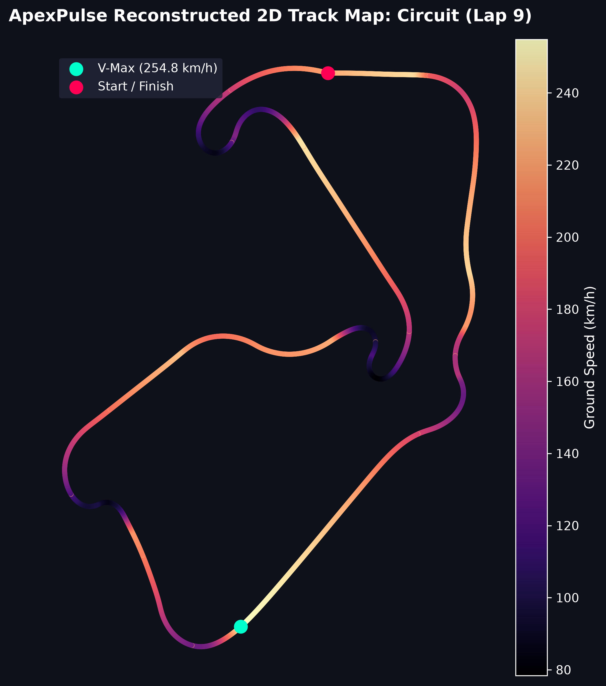
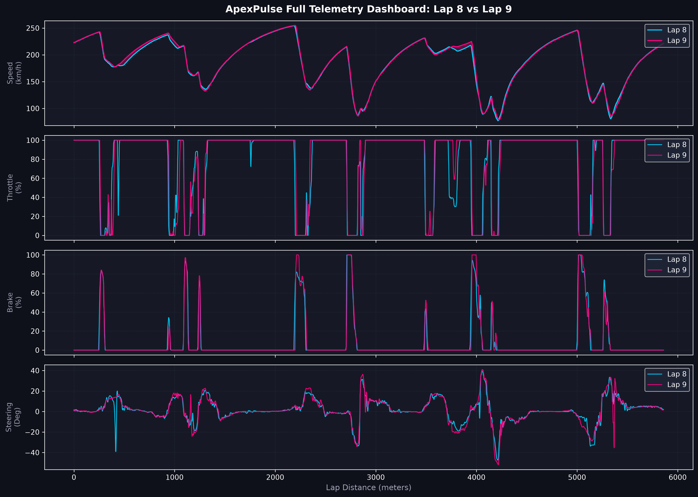
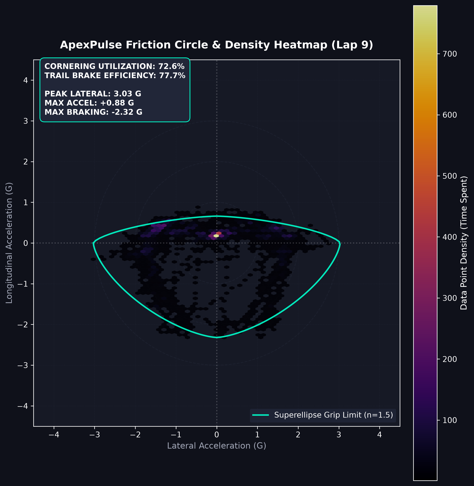
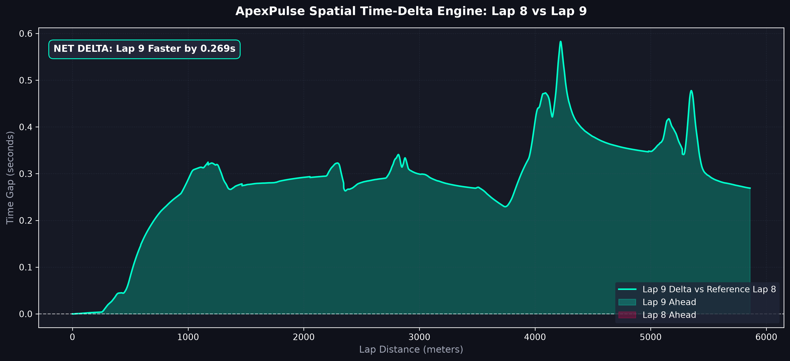
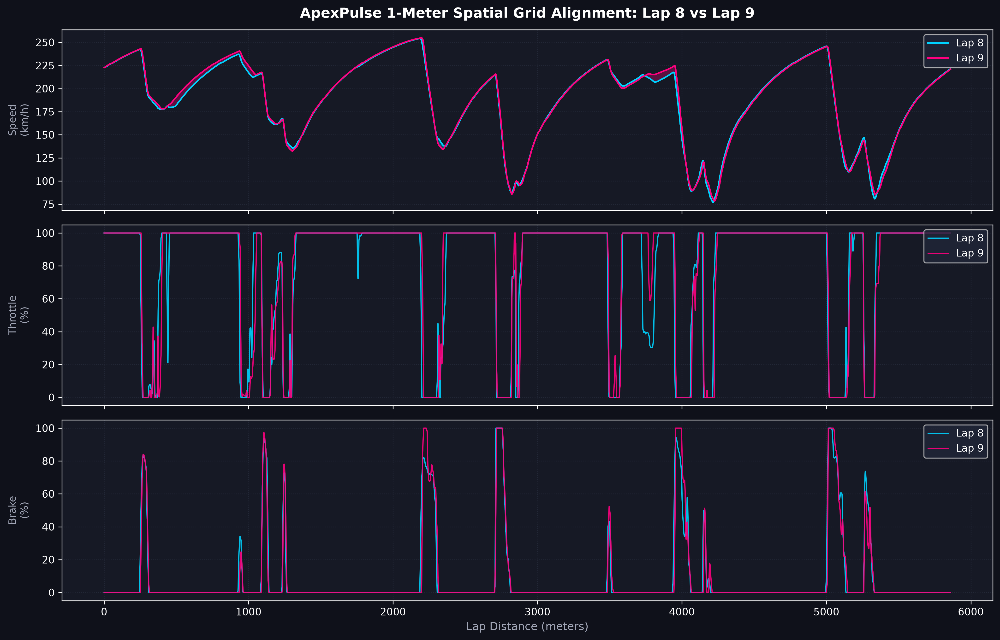

# ApexPulse | Track-Agnostic Telemetry & Dynamics Suite

**ApexPulse** is an automated telemetry engineering pipeline and vehicle dynamics analysis toolkit built for sim racing (Assetto Corsa Competizione) and real-world logging systems (e.g., MoTeC). Developed in Python using Pandas, NumPy, SciPy, FastDTW, Matplotlib, Plotly, and Streamlit, it converts raw time-series telemetry into normalized spatial datasets, $G\text{-}G$ plots, continuous spatial time-delta curves, and corner-by-corner performance breakdowns.

By decoupling analytical logic from circuit geometries through dynamic JSON configurations (`/tracks`), ApexPulse automatically detects track identity from dataset metadata and adapts to new circuits without any code modification.

---

## Key Technical Features

* **Zero-Touch Automated Data Pipeline:** Parses raw multi-row header metadata, applies rolling-median and zero-phase Butterworth filtering where timestamps support it, quarantines configured impossible speed/G samples, auto-detects track identity, and exports normalized datasets.
* **Shared Telemetry Ingestion:** Canonicalizes lap, distance, and speed channels, sorts samples, reports invalid and repeated-distance rows, and uses a single lap-distance definition across ingestion and comparison. Valid samples at repeated distances are retained for time-based analysis.
* **MoTeC LD Import:** Loads standard MoTeC i2 `.ld` sessions directly in the dashboard and CLI, aligns different-rate numeric channels to a shared time grid, preserves channel units and native sample rates, and converts recognized speed/distance units into km/h and meters. Converted/cleaned telemetry can be downloaded as CSV. `.ldx` files are not supported; export those sessions as CSV from MoTeC i2. The binary reader is based on the reverse-engineered standard `.ld` layout and has safety limits for malformed or unusually large files.
* **Interactive Session Dashboard:** Presents lap speed/delta, optional speed-profile DTW diagnostics, driver inputs, cross-session comparison, G-G sample density, track views, sector estimates, constrained optimal-lap analysis, tire metrics when channels exist, and data-quality details.
* **Reproducible Session Reports:** Writes a cleaned CSV, a data-quality JSON report, and a session report with selected-lap and sector comparisons.
* **Configurable Cubic-Spline Spatial Alignment:** Interpolates telemetry onto a uniform spatial grid (1 m by default); cubic splines preserve first- and second-derivative continuity, with a linear fallback when fewer than three unique samples are available.
* **Sample-Preserving Spatial Alignment:** Retains valid time samples even when distance is repeated at the logger's resolution, averaging by distance only for spatial interpolation.
* **Kinematic 2D Track Map Reconstruction:** Provides track visualization from logged GPS coordinates or an explicitly approximate path reconstructed from lateral acceleration when GPS is unavailable.
* **Vehicle Dynamics ($G\text{-}G$ Plots):** Visualizes lateral vs. longitudinal acceleration as sample density in the dashboard. The standalone friction-circle script also draws a superellipse envelope based on observed lap data; this is not a validated tire-grip limit.
* **Config-Driven Corner Sector Analysis:** Reads JSON distance gates to evaluate corner minimum speed ($\text{V-Min}$) and sector time deltas.
* **Automated Driver-Input Detectors:** Checks brake double-application and release, trail-brake overlap, loaded throttle snaps, throttle hesitations, dead coasting, and loaded downshifts. Rates use recorded channel sample rates when available, otherwise telemetry timestamps, with a 50 Hz fallback.
* **Spatial Mistake Clustering:** Merges repeat trigger samples within 40 m before detector counts and event tables are produced. Event corner labels use local ground-speed minima from each lap, so numbering adapts to track variants; these candidates are estimates, not surveyed geometry.
* **Corner Delta Ranking:** Compares selected-lap corner times against an actual telemetry reference lap, reports cumulative time loss in track order, and ranks the largest losses. The Sepang 2:24.650 benchmark is the fastest lap recorded in the supplied CSV; corner deltas require the reference lap's telemetry trace.
* **Automated Lap Validation:** Excludes laps below a configurable minimum distance-coverage threshold and rejects overlength laps against known track geometry before analysis.
* **Physics-Guarded Optimal Lap:** Uses dynamic programming to select the fastest sector combination that meets a configured speed-continuity tolerance at each splice. This remains a modeled benchmark, not a validated full vehicle simulation.
* **Conditional Tire Analytics:** Computes observed G-G envelope area, inner/outer temperature gradient, and a steering-speed-lateral-G integral only when required channels are present; missing channels are reported rather than fabricated.
* **Vehicle-Dynamics Estimates:** Calculates corner radius as $v^2 / |a_{lat}|$ (converting km/h to m/s and masking near-zero lateral G), per-wheel longitudinal slip against logged Ground Speed, and front/rear ride-height or suspension movement relative to a low-speed baseline. Slip from angular wheel-speed sensors requires a measured loaded tire radius and known units; unavailable inputs remain explicitly unavailable. Suspension motion is a proxy, not a direct downforce or center-of-pressure measurement.
* **Brake-Input Classification:** Reports brake ramp-up, release slopes, and brake-pressure decay as steering increases through each braking episode. Brake rates use centered 3-sample smoothing and a 4-interval slope at the channel's native rate: 80 ms for the 50 Hz CSV and about 133 ms for the 30 Hz BMW MoTeC brake channel. Abrupt release uses the configured 600 %/s default above 60 km/h, while lower-speed abrupt releases are identified separately.
* **Stint Pace Forecast:** Fits an interpretable least-squares lap-time trend for stints with at least 15 complete laps, reports fit quality and observed tire temperature/pressure trends where available, and projects when pace crosses the configured threshold. It is a pace forecast, not proof of tire-caused degradation.

---

## Repository Architecture

    ApexPulse/
    ├── assets/                  # Example dark-theme analysis plots (.png)
    │   ├── driver_comparison.png
    │   ├── friction_circle_density.png
    │   ├── lap_comparison.png
    │   ├── math_channels.png
    │   ├── telemetry_traces.png
    │   ├── time_delta.png
    │   └── track_map.png
    ├── data/                    # Supplied reference telemetry
    │   ├── 2_24_638_PB.csv       # Four-lap Sepang PB session
    │   └── raw_telemetry.ld      # BMW M235i at Sepang; one complete lap
    ├── config.yaml              # Shared coverage, grid, filter, and physics defaults
    ├── src/
    │   ├── cli.py               # Configurable clean and dashboard commands
    │   ├── config.py            # YAML configuration loader
    │   ├── core/                # Analysis, optimal lap, derived channels, sector logic
    │   ├── pipeline/            # Telemetry ingestion and cleaning
    │   └── visualization/       # Dashboard, standalone plots, shared Matplotlib style
    ├── tests/                   # Telemetry, analysis, CLI, and dashboard tests
    ├── tracks/                  # Circuit sector configuration files (.json)
    │   ├── Barcelona.json
    │   ├── Bathurst.json
    │   ├── Imola.json
    │   ├── Monza.json
    │   ├── Nurburgring.json
    │   ├── Sepang.json
    │   ├── Silverstone.json
    │   ├── Spa.json
    │   └── Suzuka.json
    ├── .github/workflows/       # Automated tests and compilation on pushes/PRs
    ├── .streamlit/              # Dashboard theme configuration
    ├── .vscode/settings.json    # Default project interpreter and Explorer exclusions
    ├── .gitignore               # System cache & build exclusion filters
    ├── README.md                # Project documentation
    └── requirements.txt         # Runtime dependencies

---

The source tree is divided into `src/pipeline/`, `src/core/`, and `src/visualization/`. Generated reports go in the ignored `reports/` folder; the local `.venv/` environment is also ignored and should not be committed.

## File Naming Convention

Track identity is read from the filename or telemetry metadata. The default `2_24_638_PB.csv` is a four-complete-lap Sepang session and supports lap/stint analysis. `raw_telemetry.ld` is a separate BMW M235i MoTeC sample at Sepang, retained to validate LD importing; it has one complete lap.

The supplied Sepang PB CSV and BMW MoTeC LD are included under `data/`. Generated cleaned CSVs remain ignored by Git.

---

## Quickstart

### 1. Installation
Clone the repository and install required dependencies:

    git clone [https://github.com/ItzJTz/ApexPulse.git](https://github.com/ItzJTz/ApexPulse.git)
    cd ApexPulse
    py -3.11 -m venv .venv
    .\.venv\Scripts\python.exe -m pip install -r requirements.txt

In VS Code, select `.venv\Scripts\python.exe` with **Python: Select Interpreter** if it is not already selected. The workspace settings provide this as the default and hide `.venv` from the Explorer; `.gitignore` prevents it from being committed.

### 2. Clean a session and create reports

Run from the repository root. The input may be a standard MoTeC i2 `.ld` file, a raw MoTeC-style CSV, or a previously cleaned CSV:

    .\.venv\Scripts\python.exe -m src.cli clean data\2_24_638_PB.csv --output-dir reports

The dashboard accepts `.ld` and `.csv` uploads. It converts `.ld` channel data to the dashboard's aligned telemetry table; in the **Data quality** tab, download the converted/cleaned data as CSV. `.ldx` files are not supported—export them to CSV in MoTeC i2 first. For channels recorded at different rates, values are resampled to a shared timeline at the highest supported channel rate; discrete lap and gear channels use nearest-sample alignment. The importer converts recognized speed units (mph or m/s) to km/h and distance units to meters, and reports assumptions for unrecognized units.

The command writes three artifacts into `reports/`: a normalized, complete-lap CSV; a data-quality JSON file with quarantined rows, channel mappings, units when supplied, missing optional-channel rates, and lap coverage; and a session JSON report with driver-input and vehicle-dynamics summaries for each valid lap, lap/sector comparisons, a stint forecast when at least 15 laps are available, and physically constrained optimal-lap analysis. Use `--minimum-lap-fraction` to adjust the complete-lap threshold, or `--report-json path.json` to choose the session-report location. Defaults are centralized in `config.yaml`.

Track identity is resolved from the input filename or MoTeC `Venue` metadata against JSON files in `tracks/`. If the track is unknown, generic lap analysis still works, but track-specific sectors are not guessed.

### 3. Explore the session in one dashboard

Start the dashboard from the repository root:

    .\.venv\Scripts\python.exe -m src.cli dashboard

Then follow these steps:

1. In the left sidebar, either upload a MoTeC `.ld` file or telemetry CSV, or choose a `.ld`/`.csv` file already in `data/`. If a file is uploaded, it takes precedence over the local-file selector.
2. Set **Minimum lap coverage**. The default is 90%; increase it to exclude more partial laps or lower it only when appropriate for your session.
3. Select a **Reference lap** and a **Compared lap**. The default local file is `2_24_638_PB.csv`, which contains four complete laps. The BMW LD sample contains one complete lap and is primarily included for MoTeC importer validation. Lap benchmarks are selected by track.
4. Open the tabs to review the session:

   * **Overview:** lap speed traces and cumulative time delta. Positive delta means the compared lap is ahead. An optional DTW panel aligns speed-profile shape for diagnosis only; it does not modify the time delta.
   * **Driver inputs:** available throttle, brake, steering, and G channels aligned by distance, plus seven input-mistake summaries, event locations, and 40 m clusters.
   * **Vehicle dynamics:** selected-lap corner-radius estimates, wheel-slip traces when wheel speed and loaded radius are available, suspension/ride-height movement relative to a low-speed baseline, and brake ramp/release analysis. Slip is referenced to logged Ground Speed (not GPS speed); sensor and vehicle calibration are required for physical interpretation.
   * **G-G:** measured lateral/longitudinal acceleration sample density. Brighter cells mean more samples in that acceleration range; empty ranges are blank. Lateral G is signed left/right. Longitudinal G is plotted as logged; for Assetto Corsa's `CG Accel Longitudinal` channel, positive means acceleration and negative means braking. This sample-density plot does not estimate a validated tire-grip envelope or unused grip.
   * **Track map:** logged GPS positions or vehicle coordinates when present; otherwise an explicitly labeled approximate path from lateral acceleration. Numbered corner markers use approximate apex distances from the track configuration. Assetto Corsa channels such as `Car Coord X`/`Car Coord Y` and `CG Accel Lateral`/`CG Accel Longitudinal` are recognized.
   * **Sectors:** minimum speeds and distance-integrated sector and corner times when the track is identified and a matching configuration is available. Corner deltas compare the selected laps and rank losses against the selected reference trace. The 2:24.650 Sepang target cannot provide corner-by-corner data unless a matching reference lap is present. Corner distances from published layouts are approximate and should be checked against telemetry.
   * **Data quality:** included/excluded laps, dropped/duplicate rows, optional-channel completeness, and downloads for the cleaned CSV and JSON report.
   * **Driver comparison:** upload a second session to compare its fastest complete lap with the fastest complete lap from the main session. Both files should be from the same circuit and use compatible distance units. If track metadata is missing, confirm this manually in the tab.
   * **Optimal lap:** uses dynamic programming to choose the fastest micro-sector combination within the configured seam-speed tolerance. It remains a theoretical benchmark assembled from different laps, not a full vehicle simulation.
   * **Tire analytics:** averages per-wheel inner/outer temperatures when available, plots their difference against lateral G, reports per-lap G-G envelope area and steering-speed-lateral-G integral, and fits the stint pace forecast. The forecast requires at least 15 complete laps by default; `tire_analysis.degradation_minimum_laps` and `tire_analysis.degradation_lap_time_drop_s` configure its minimum data and threshold. G-G area change and a lap-time trend alone do not prove tire degradation.

5. Use the data-quality tab to check which laps and samples were retained before interpreting comparisons or downloading the cleaned data and report.

The dashboard reports sector times as estimates. Logged vehicle coordinates and reconstructed paths are not surveyed circuit geometry, and GPS coordinate values are shown as supplied by the data source. Track-specific sectors require the filename or source metadata to identify a track with a matching JSON configuration in `tracks/`.

To run the separate command-line sector report, provide an LD or CSV whose filename or Venue metadata identifies its track:

    python -m src.core.sector_analysis data/2_24_638_PB.csv

The default PB CSV contains four complete laps, so this compares its last two valid laps.

The dashboard and command-line tools share lap alignment and telemetry processing. Synthetic-data unit tests cover fastest-lap selection, spatial alignment, repeated-distance handling, and optimal-lap calculations; real cross-driver sessions are still needed to validate results against actual driver data.

To compare two real sessions, provide one CSV for each driver. The script selects the fastest complete lap in each file, aligns the speed traces by distance, and saves the plot to `assets/driver_comparison.png`:

    .\.venv\Scripts\python.exe -m src.visualization.driver_comparison data\driverA_Silverstone.csv data\driverB_Silverstone.csv

Both files should be from the same circuit and use compatible distance units. Use `--output path\to\comparison.png` to choose a different image path. For a plot-only demo without a second driver's data, `--synthetic-benchmark` generates synthetic speed for Driver B; do not treat that result as a real driver comparison.

`python -m src.core.math_channels` generates the optional derived-channel plot. Its downforce multiplier, brake-bias value, and brake-active threshold are configured under `vehicle` in `config.yaml`; treat those channels as illustrative until calibrated for the vehicle. Tire analytics require corresponding temperature, acceleration, and steering signals; the dashboard explains which metrics cannot be calculated for a session. The optional DTW view matches speed-profile shape only and never replaces the distance-based lap delta.

### 4. Run automated checks

    .\.venv\Scripts\python.exe -m unittest discover -s tests -v
    .\.venv\Scripts\python.exe -m compileall -q src tests

GitHub Actions runs the same tests and Python compilation check for pushes and pull requests.
---

## Visual Analytics Showcase

### 1. Reconstructed 2D Track Map & Speed Heatmap

### 2. Multi-Channel Telemetry Dashboard

### 3. G-G Sample-Density Plot

### 4. Continuous Spatial Time-Delta Engine

### 5. Spatial Lap Comparison with Differential Shading

Creator: JT
Focus: Data Engineering | Vehicle Dynamics | GT Motorsport
